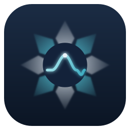
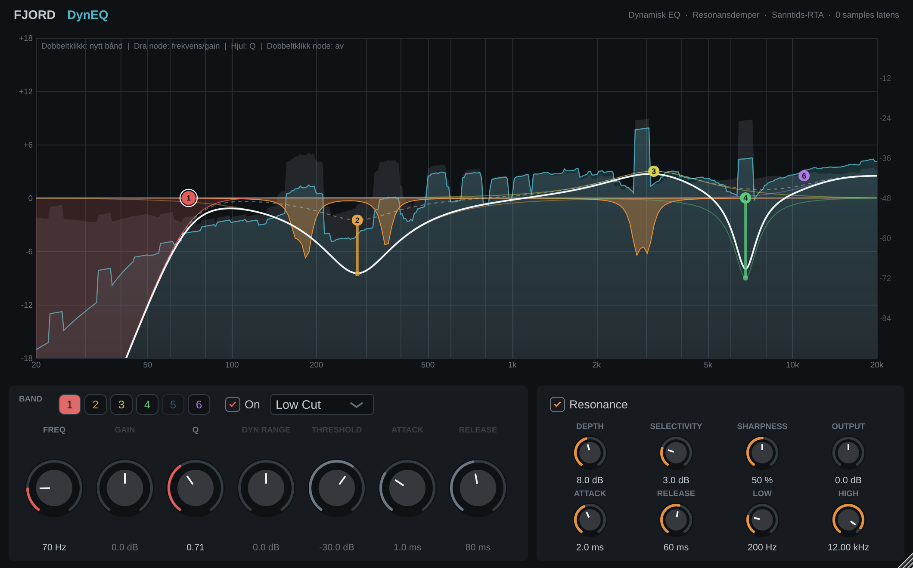

# Fongen DynEQ

*English · [Norsk](README.no.md)*

If you like this app and want to support me:

<a href="https://www.buymeacoffee.com/trondmorsej" target="_blank"></a>

Dynamic EQ and resonance suppressor in VST3 format (and AU on Mac), in the same spirit as FabFilter Pro-Q and Soothe. Everything is IIR, so the plugin has **0 samples of latency** and can be used live. Built with JUCE 9.0.5.



## Features

- **Six dynamic EQ bands**: Bell, Low Shelf, High Shelf, Low Cut, High Cut (24 dB/oct) and Notch.
- **Fast dynamics**: the gain is updated every sample. With a 0.5 ms attack the cut is in place after 0.15 ms.
- **Resonance suppressor**: 64 detector bands are compared with their neighbours. Only what sticks out above the smoothed spectral curve is attenuated, and the curve is shown in orange.
- **Real-time RTA**: 4096-point FFT at 60 frames per second. Input is shown in grey and output in blue, with a 4.5 dB/oct tilt as in Pro-Q.
- **Draggable nodes** directly in the spectrum, with the dynamic movement shown as a line from the node to the actual gain.

## Using the spectrum

| Action | Result |
|---|---|
| Double-click an empty area | New band where you clicked |
| Drag a node | Changes frequency and gain |
| Mouse wheel over a node | Changes Q |
| Double-click a node | Turns the band off |

## Controls

### Bands
| Control | What it does |
|---|---|
| **Freq / Gain / Q** | Regular EQ. Gain applies to bells and shelves. |
| **Dyn Range** (−24 to +24 dB) | How much the gain changes when the signal in the band crosses the threshold. Negative = cut (compression), positive = boost. 0 = static EQ. |
| **Over / Under** | Whether the band reacts when the level goes **over** the threshold (compression/de-essing, or boost with a positive range) or is **under** the threshold (expansion, or lifting quiet passages). |
| **Threshold** (−80 to 0 dBFS) | The level in the band where the dynamics start. Full effect is reached about max(6, \|range\|) dB past the threshold. |
| **Attack / Release** | Detector response time (0.1–200 ms / 5–2000 ms). |

**The VU ring around Threshold** shows the level the detector actually measures in the band, on the same scale as the knob. The white mark is the threshold, and the small mark is peak hold. The part of the ring where the band reacts lights up in the band's colour, and the THRESHOLD label lights up when you hit it. The ring works before Dyn Range is turned up, so you can set the threshold first.

The detector listens to the same frequency range as the band: band-pass for bell, low-pass for low shelf and high-pass for high shelf. Left and right are linked.

### Resonance
| Control | What it does |
|---|---|
| **Depth** (0–18 dB) | Maximum attenuation per band. |
| **Selectivity** (0–12 dB) | How far a band must stick out above its neighbours before it is attenuated. Higher = only clear resonances. |
| **Sharpness** | Narrow or wide cuts (Q 4–16), and how wide the neighbour average is. |
| **Attack / Release** | How fast the attenuation comes in and lets go. |
| **Low / High** | The frequency range the attenuation applies to. |
| **Output** | Output level. |

## How it works

- **Filters**: Simper's trapezoidal-integrated SVF (Cytomic). It handles coefficients changing every sample without clicks. The GUI curves are computed exactly from the same formula, and the tests show 0.00 dB difference between the drawn curve and the actual sound.
- **Resonance suppressor**: feed-forward from the input, no feedback. It uses an IIR filter bank instead of an FFT, so it has zero latency, but somewhat coarser frequency resolution than Soothe. Tones sitting close together in broadband noise are therefore not always found.
- **RTA**: the audio thread only writes to a lock-free ring buffer. FFT and smoothing happen on the GUI thread.
- **CPU**: about 10 % of one core with all six bands dynamic and the resonance suppressor on (stereo, 48 kHz, measured on the build server).

## Building

### Via GitHub (recommended)
Push the repo to GitHub. The workflow in `.github/workflows/build-macos.yml` builds VST3 and AU as a universal binary (Apple Silicon and Intel), runs the DSP tests and pluginval, and creates a `.pkg` installer. Finished versions are under **Releases** on GitHub. A new release is created automatically when `VERSION` in `CMakeLists.txt` is increased and pushed to `main`. Builds between releases are under **Actions → latest run → Artifacts**.

### Locally on Mac
```bash
cmake -B build -G Xcode
cmake --build build --config Release --target FongenDynEQ_VST3 FongenDynEQ_AU
```
Copy `Fongen DynEQ.vst3` to `~/Library/Audio/Plug-Ins/VST3/` and `Fongen DynEQ.component` to `~/Library/Audio/Plug-Ins/Components/`.

## Tests
`cmake -B build -DFONGEN_BUILD_TESTS=ON`, then:
- `DspTest`: filter curves, dynamics, response time, resonance suppressor and CPU.
- `HostTest <plugin.vst3> <image.png>`: loads the actual VST3 file, tests 44.1/48/96 kHz and blocks of 32–1024 samples, random automation, state, bypass and latency.
- `GuiSnapshot <image.png>`: draws the GUI with a test signal.

## Code structure
| File | Contents |
|---|---|
| `Source/DynEqDsp.h` | The DSP core (SVF, dynamic bands, resonance suppressor, analytic curves). No JUCE dependency. |
| `Source/PluginProcessor.*` | Parameters (APVTS), audio processing, ring buffer for the analyser. |
| `Source/PluginEditor.*` | Spectrum, RTA, nodes and control panels. |
| `assets/` | Logo as SVG and PNG (256, 512, 1024). Used in the plugin window and as the icon for the standalone version. |

## License
JUCE is licensed under AGPLv3 or a commercial license. For private use this is not a problem. If the plugin is shared or sold as closed source, a commercial JUCE license may be required.
