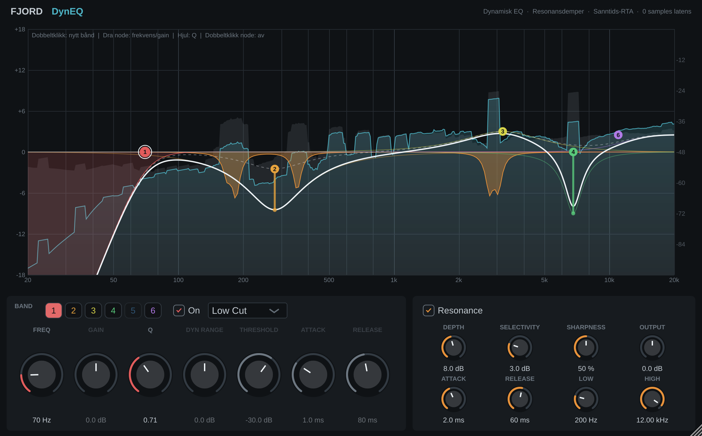

# Fjord DynEQ

Dynamisk EQ og resonansdemper i VST3-format (og AU på Mac), i samme ånd som FabFilter Pro-Q og Soothe. Alt er IIR, så pluginen har **0 samples latens** og kan brukes live. Bygget med JUCE 9.0.5.



## Funksjoner

- **Seks dynamiske EQ-bånd**: Bell, Low Shelf, High Shelf, Low Cut, High Cut (24 dB/okt) og Notch.
- **Rask dynamikk**: gainen oppdateres hver sample. Med attack 0,5 ms er kuttet på plass etter 0,15 ms.
- **Resonansdemper**: 64 detektorbånd sammenlignes med naboene sine. Bare det som stikker opp over den glatte spekterkurven blir dempet, og kurven vises i oransje.
- **Sanntids-RTA**: FFT med 4096 punkter, 60 bilder i sekundet. Inngang vises i grått, utgang i blått, med 4,5 dB/okt helning som i Pro-Q.
- **Dragbare noder** direkte i spekteret, med dynamisk utslag vist som en strek fra node til faktisk gain.

## Bruk i spekteret

| Handling | Resultat |
|---|---|
| Dobbeltklikk på tomt område | Nytt bånd der du klikket |
| Dra en node | Endrer frekvens og gain |
| Musehjul over node | Endrer Q |
| Dobbeltklikk på node | Slår båndet av |

## Kontroller

### Bånd
| Kontroll | Hva den gjør |
|---|---|
| **Freq / Gain / Q** | Vanlig EQ. Gain gjelder bell og hyller. |
| **Dyn Range** (-24 til +24 dB) | Hvor mye gainen endres når signalet i båndet går over terskel. Negativ = kutt (kompresjon), positiv = løft. 0 = statisk EQ. |
| **Threshold** (-80 til 0 dBFS) | Nivået i båndet der dynamikken begynner. Fullt utslag nås ca. max(6, \|range\|) dB over terskel. |
| **Attack / Release** | Detektorens reaksjonstid (0,1–200 ms / 5–2000 ms). |

Detektoren lytter på samme frekvensområde som båndet: båndpass for bell, lavpass for low shelf og høypass for high shelf. Venstre og høyre er linket.

### Resonance
| Kontroll | Hva den gjør |
|---|---|
| **Depth** (0–18 dB) | Maks demping per bånd. |
| **Selectivity** (0–12 dB) | Hvor mye et bånd må stikke opp over naboene før det dempes. Høyere = bare tydelige resonanser. |
| **Sharpness** | Smale eller brede kutt (Q 4–16), og hvor bredt nabosnittet er. |
| **Attack / Release** | Hvor raskt dempingen kommer og slipper. |
| **Low / High** | Frekvensområdet dempingen gjelder. |
| **Output** | Utgangsnivå. |

## Hvordan det fungerer

- **Filtre**: Simpers trapesintegrerte SVF (Cytomic). Den tåler at koeffisientene endres hver sample uten klikk. GUI-kurvene regnes ut eksakt fra samme formel, og testene viser 0,00 dB avvik mellom tegnet kurve og faktisk lyd.
- **Resonansdemper**: feed-forward fra inngangen, ingen tilbakekobling. Den bruker en IIR-filterbank i stedet for FFT, så den har null latens, men noe grovere frekvensoppløsning enn Soothe. Toner som ligger tett i bredbåndsstøy blir derfor ikke alltid funnet.
- **RTA**: lydtråden skriver bare til en låsfri ringbuffer. FFT og glatting skjer i GUI-tråden.
- **CPU**: ca. 10 % av én kjerne med alle seks bånd dynamiske og resonansdemperen på (stereo, 48 kHz, målt på byggeserveren).

## Bygging

### Via GitHub (anbefalt)
Push repoet til GitHub. Workflowen i `.github/workflows/build-macos.yml` bygger VST3 og AU som universal binary (Apple Silicon og Intel), kjører DSP-testene og pluginval, og lager en `.pkg`-installer. Last den ned under **Actions → siste kjøring → Artifacts**. En tag som `v1.0.0` lager i tillegg en release.

### Lokalt på Mac
```bash
cmake -B build -G Xcode
cmake --build build --config Release --target FjordDynEQ_VST3 FjordDynEQ_AU
```
Kopier `Fjord DynEQ.vst3` til `~/Library/Audio/Plug-Ins/VST3/` og `Fjord DynEQ.component` til `~/Library/Audio/Plug-Ins/Components/`.

## Tester
`cmake -B build -DFJORD_BUILD_TESTS=ON`, deretter:
- `DspTest`: filterkurver, dynamikk, reaksjonstid, resonansdemper og CPU.
- `HostTest <plugin.vst3> <bilde.png>`: laster selve VST3-fila, tester 44,1/48/96 kHz og blokker på 32–1024 samples, tilfeldig automasjon, state, bypass og latens.
- `GuiSnapshot <bilde.png>`: tegner GUI-et med testsignal.

## Kodestruktur
| Fil | Innhold |
|---|---|
| `Source/DynEqDsp.h` | DSP-kjernen (SVF, dynamiske bånd, resonansdemper, analytiske kurver). Ingen JUCE-avhengighet. |
| `Source/PluginProcessor.*` | Parametere (APVTS), lydprosessering, ringbuffer til analysatoren. |
| `Source/PluginEditor.*` | Spekter, RTA, noder og kontrollpaneler. |

## Lisens
JUCE er lisensiert under AGPLv3 eller kommersiell lisens. For privat bruk er det uproblematisk. Skal pluginen deles eller selges som lukket kode, kan det kreves en kommersiell JUCE-lisens.
